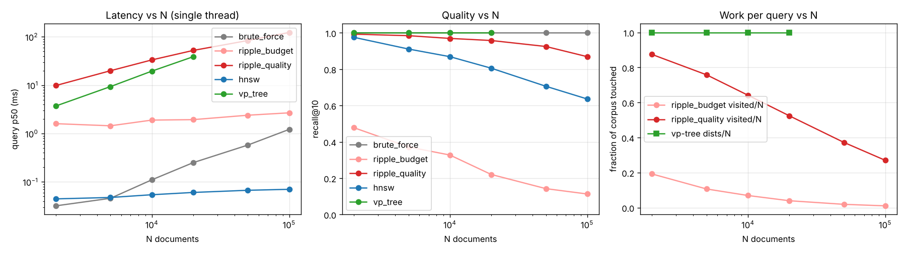
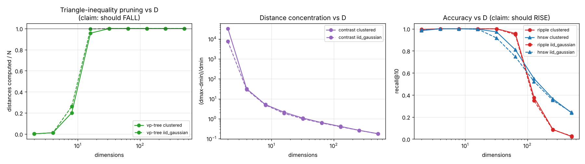
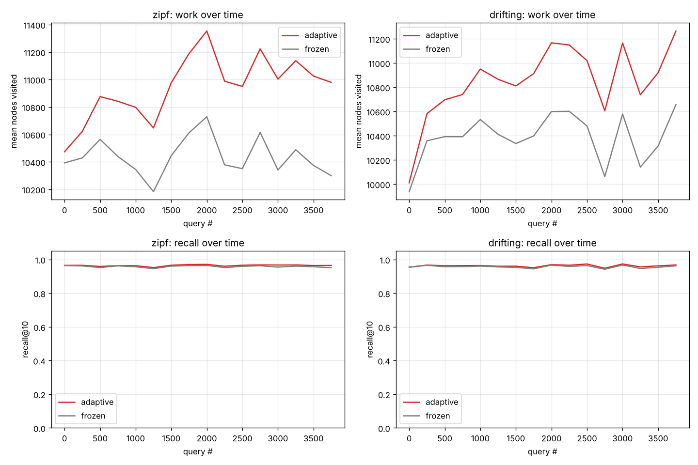
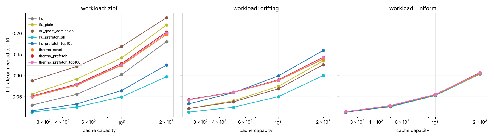

# Ripple Search POC — an honest test of the "thermodynamic ripple engine"

This project takes a speculative architecture — the "Emergent Ripple Engine" —
and asks whether its claims survive measurement. The concept:
documents as nodes at hypercube corners, queries as kinetic-energy ripples
with decay, Hebbian path-strengthening, thermodynamic caching, and log-time
consolidation — with claims that it beats traditional databases and that
**more data, more dimensions and more time make it faster and more accurate**.

This repository implements that architecture faithfully (`ripple_search/`),
calibrates it fairly (176 configurations, Pareto-front selection), and tests
every claim against exact ground truth and real engines: brute-force vector
scan, **HNSW** (hnswlib), an instrumented **VP-tree**, **SQLite FTS5**,
**PostgreSQL GIN/tsvector**, and a real **Oracle Database Free with Oracle
Text** running in a container. Six literature passes over primary sources
(where reachable — access caveats are documented in `docs/FINDINGS.md`) were
done *before* benchmarking. The study was then adversarially reviewed by
independent passes attacking fairness, correctness, statistics and verdict
overreach; every confirmed finding was fixed and the affected experiments
re-run (multi-seed where margins were small) before publication.

The claims, as falsifiable statements: `docs/HYPOTHESIS.md`.
The rules of the game and known limitations: `docs/METHODOLOGY.md`.

One discipline note up front: this engine is Python/numpy while HNSW, FTS5
and Oracle are C/C++. Per unit of identical work the interpreter costs
~300–400× (measured: 4.6 µs vs 12 ns per distance computation), so
**algorithmic verdicts below are drawn from work counters** (nodes visited,
true distance computations, recall), and wall-clock figures are labeled as
prototype numbers.

## Verdicts

| # | Claim | Verdict | Decisive measurement |
|---|-------|---------|----------------------|
| C1a | "As data grows, search speed stays flat" | **Refuted** | The claim has two horns and both fail. Hold quality: holding the quality operating point, visited nodes grow 1,749 → 27,013 as N goes 2k → 100k (work ~N^0.70 by counter fit; prototype p50 9.9 → 123.6 ms) while recall still slides 0.993 → 0.869. Hold work ~flat (budget config, 385 → 1,028 visited): recall collapses 0.478 → 0.113. Recall-matched at N=100k, HNSW (ef=256, recall 0.898) answers in 0.25 ms — the 495× wall-clock gap is mostly interpreter overhead, but the counter gap stands: ~27k distance evaluations vs thousands, at lower recall. [exp1, exp1b] |
| C1b | "Traditional engines slow down linearly or quadratically with N" | **Mixed** — and where true, the hypothesis doesn't help | For indexed point/conjunctive access the premise is false by construction (hash ~O(1), B-tree O(log N)); Oracle Text indexed 10,788 docs in 2.7 s and answers in 11.5 ms. But measured honestly: SQLite FTS5's *disjunctive ranked* retrieval grew 96.4× over 100× more docs — top-k OR evaluation scans every term's postings and FTS5 has no WAND-style dynamic pruning, so that query shape IS ~linear. The catch: the ripple engine's own work also grows (~N^0.70) at falling recall, so it loses even where the premise holds; HNSW is the one engine measured near-flat (0.045 → 0.070 ms over 50× data). [exp1c, exp7, exp1] |
| C2 | "More dimensions = sharper pruning and more accuracy" | **Refuted** | Triangle-inequality pruning (instrumented VP-tree) touches 0.2% of the DB at d=2, 96% (clustered) / 99.6% (i.i.d.) at d=16, and **100% (= brute force) at d≥32** in both regimes. Relative contrast collapses 33,113 → 0.18. The ripple's own recall at fixed energy falls 1.00 → 0.02 from d=32 to d=512. Exactly the curse of dimensionality proved by Weber et al. 1998 and Beyer et al. 1999. [exp2] |
| C3 | "Hebbian trails make it faster and more precise over time" | **Refuted for speed; precision gain real but marginal** | Identical frozen-twin control, 3 seeds, 4,000-query streams: the adaptive engine does **+4.5–4.9% more work** (strengthened edges slow energy decay, so the ripple spreads wider — the mechanism self-defeats on its own terms) and gains **+0.005–0.006 recall**, positive in 96/96 windows. OOD queries after adaptation: unharmed (+0.006 to +0.007 vs frozen, 3-seed means). "Faster over time" is backwards; "more precise" is a half-point. [exp3] |
| C4 | "Thermodynamic caching beats reactive LRU/LFU" | **Refuted on zipf; statistical tie on its own best-case workload** | Mean hit rate across capacities, 3 seeds. Zipf: LFU wins — ghost-LFU 0.151, plain LFU 0.125, the hypothesis's bundle (thermo + neighborhood) 0.114±0.004. Drifting ("train of thought"): bounded-prefetch LRU wins 0.088; thermo bundle 0.084±0.003 vs plain LRU 0.082±0.003 (paired per-seed edge +0.0015–0.0026 — small but consistently positive). One genuinely clever emergent property: energy-weighted admission makes full-neighborhood prefetch *harmless* (thermo_prefetch ≈ thermo_exact) where the same admission poisons LRU (0.046, worst in grid) — the physics self-protects against its own pollution, but never wins. Decayed-temperature eviction is mathematically the LRFU family (1990s); Oracle's buffer cache has used touch-count heat for decades. [exp4] |
| C5 | "Log-time consolidation keeps the search field small and fast" | **Refuted** | Consolidating a 50k corpus (90% archival) to 9.1k active nodes cuts graph *settles* 7× (18.6k → 2.6k) — but true distance computations **rise 60%** (18.6k → 29.9k) because every settled macro-hub's members must be scored. The 1.3–1.5× prototype latency gain comes from those evaluations being batched in numpy, not from less work. Recall falls 0.90 → 0.80 and 0.92 → 0.85. (Label caveat: ground truth spans the full corpus; the "recent-seeded" stream's truth sets are 81% archival — published as `truth_composition`.) Time-partitioned indexes give real systems this trade without the recall loss. [exp6] |
| C6 | "Faster than search in Teradata or Oracle databases" | **Refuted** | Against the real thing (Oracle Text CONTEXT index, ACCUM relevance, FUTC license verified — no DeWitt clause): Oracle answers the same 300 Reuters queries at p50 **11.5 ms** (7.7 ms at 10-word queries; index build 2.7 s) where the ripple prototype needs 39.4 ms — and even granting the ripple a free ~375× native-code speedup, its 3.7k distance computations would land it around brute force's territory, not ahead of anything. Meanwhile exact brute-force vector search (0.48 ms + 2.5 ms query embedding) and HNSW (0.06 ms + 2.5 ms) both beat Oracle end-to-end at equal-or-better quality — i.e. the *existing* state of the art already wins this comparison; the ripple mechanism adds nothing to it. Teradata cannot be raced (registration-gated VM; no native full-text engine — its identity is ~O(1) hash primary-index access, which no diffusion process beats). [exp5, exp5b, exp7] |

## The autopsy, in one paragraph

The hypothesis is five known mechanisms wearing a physics costume, plus two
claims that are provably backwards. Content-addressable memory on hypercube
corners with activation spreading is **Kanerva's Sparse Distributed Memory
(1988)**; query-driven self-strengthening paths are **ant-colony routing /
spreading activation / adaptive indexing** (all with measured, modest, known
trade-offs); temperature-decay eviction is the **LRFU family (1990s)** — and
Oracle's buffer cache has used touch-count "heat" for decades; neighborhood
prefetching is **semantic caching / correlated prefetch**, whose cache-
pollution failure mode we measured (it is the worst arm in the grid under
LRU eviction; the thermo cache's energy-weighted admission neutralizes the
pollution without ever outscoring simpler policies). The two backwards
claims: high dimensionality makes geometric pruning *vacuous*, not sharper
(100% of the database touched from d=32), and "flat speed as N grows" is
purchasable only by letting recall collapse (0.478 → 0.113). The deepest
measured finding: **energy diffusion is the wrong physics for search** — it
spreads effort isotropically around entry points, while greedy graph
navigation (HNSW) *descends* toward the query; at matched recall the
diffusion engine evaluates roughly an order of magnitude more candidates and
still recalls less. What *is* salvageable — proximity-graph search, bounded
semantic prefetch on drifting workloads, time-partitioned compaction — is
precisely what production systems already do, minus the metaphor.

## Experiments

Plots in `results/plots/`, raw numbers in `results/*.json` (multi-seed runs
as `*_seedN.json`), each experiment file's docstring states the claim it
tests.

### exp0 / exp0b — calibration (no strawmen)
Grid search over 176 ripple configurations (48 physics + 128 address-width/
energy) on a validation query set with a seed disjoint from all experiments.
The full recall/work Pareto front is published; experiments carry two
operating points (budget: ≤5% of corpus visited; quality: recall 0.97 at
N=20k, visiting ~54%). The front **is** the finding: no configuration is
both fast and accurate. Known gap, flagged in review: the adaptive-mechanism
hyperparameters (Hebbian rates, cache heat constants) were set a priori, not
swept — C3/C4 verdicts apply to the mechanism as parameterized here, so
exp3/exp4 run over 3 seeds to bound seed variance (reported mean ± sd).

### exp1 / exp1b / exp1c — scaling in N

All engines at fixed settings while N grows 2k → 100k (both engines' quality
falls with N at fixed settings — the comparison is shape-vs-shape, and
exp1b adds the recall-matched point: HNSW ef-sweep at N=100k). exp1c
measures a real inverted index's N-scaling on synthetic Zipf text
(2k → 200k docs): FTS5's 10-term disjunctive queries scale ~linearly
(96.4× / 100×), the one measured regime where the hypothesis's premise about
traditional engines holds — and where the ripple still loses.

### exp2 — dimensionality

The instrumented VP-tree counts exactly how much the triangle inequality
prunes per dimensionality, on clustered and i.i.d. data; plus distance
concentration and recall-at-fixed-budget for ripple and HNSW. One nuance the
hypothesis accidentally touches: for **random binary codes in Hamming
space**, high-D concentration is a *feature* (quasi-orthogonality —
Kanerva's hyperdimensional computing; measured in the same run via Hamming
separation). It does not transfer to metric nearest-neighbor on correlated
real data, which is what a search engine does.

### exp3 — Hebbian adaptation (3 seeds)

Identical twin engines (same build, same stream), one adaptive, one frozen.
The estimand is the **paired per-window delta**: recall +0.0064±0.0001
(zipf), +0.0053±0.0003 (drifting), positive in 96/96 windows — a real,
small, consistent precision gain — at +4.5–4.9% more work, the opposite of
"faster". OOD recall after adaptation: 0.961–0.968 adaptive vs 0.957–0.958
frozen (no damage).

### exp4 — thermodynamic cache (3 seeds)

Probe-before-admit hit rates on exact top-10 needed sets; 8 policies
ablating admission (exact / top-100-energy / full neighborhood) × eviction
(LRU / plain LFU / ghost-LFU / temperature decay). Note the baseline
honesty: the policy labeled `lfu_ghost_admission` keeps ghost frequencies
and gates admission — TinyLFU-family behavior, stronger than plain LFU, and
it wins zipf outright. Uniform workload: all policies ~equal (capacity-
bound), no arm catastrophically pollutes except full-neighborhood-LRU.

### exp5 / exp5b / exp7 — real text, real engines (Reuters-21578)
TF-IDF→LSA (256-d) embeddings for vector engines; native tokenization for
text engines; 300 lead-text queries; same-category precision@10 (self
excluded) as the common quality metric. catP@10 is shown to 2 decimals: at
n=300 its standard error is ≈0.014, so differences under ~0.03 are noise.

| engine | p50 search (40w) | + per-query embed | p50 (10w) | catP@10 |
|---|---|---|---|---|
| HNSW (ef=64) | 0.06 ms | ≈2.5 ms end-to-end | — | 0.88 |
| brute-force numpy (exact) | 0.48 ms | ≈3.0 ms end-to-end | — | 0.88 |
| **Oracle Text CONTEXT (ACCUM)** | 11.5 ms | n/a (parses internally) | 7.7 ms | 0.81 |
| SQLite FTS5 (BM25) | 40.3 ms | n/a | 7.6 ms | 0.85 |
| ripple (quality config) | 39.4 ms | ≈42 ms end-to-end | — | 0.86 |
| PostgreSQL GIN + ts_rank | 57.4 ms | n/a | 22.1 ms | 0.78 |

Notes. Vector engines pay a 2.48 ms per-query embedding cost (measured
single-query, not batch-amortized — the batch figure understates it ~54×).
40-term queries are pathological for postings-list engines, hence the
10-word column (exp5b/exp7). PostgreSQL's ts_rank length-normalization was
swept (0/2/32) the way Oracle's operator was; its default was already its
best. Oracle runs in Docker over a localhost TCP bridge; FTS5 is in-process;
PostgreSQL uses a unix socket — absolute cross-engine milliseconds carry
that caveat, orders of magnitude do not. An earlier Oracle run using the `|`
(OR) operator scored catP@10 = 0.36 because OR ranks by *maximum* single-
term score; the published numbers use `ACCUM`, the fair reading. The mistake
is documented deliberately: misranked operators are exactly how casual
benchmarks slander engines. Oracle Text index build: 2.7 s (+1.1 s data
load) for 10,788 docs.

### exp6 — temporal consolidation
Before/after consolidating a 50k corpus (90% archival): 5.5× node
compression; graph settles −7×; **true distance computations +60%**
(macro-member expansion); prototype p50 81→61 ms (recent-seeded) and
90→60 ms (archive-seeded); recall −0.10 / −0.065. The one mechanism whose
prose sounds like a real systems technique — and the measurement shows the
"small active field" is an accounting illusion: the work moves into the
hubs, it doesn't disappear.

## "Can you really benchmark Oracle? What about Teradata?"

**Oracle — yes, legally.** Oracle Database Free ships under the *Free Use
Terms and Conditions* (embedded in the container image at
`$ORACLE_HOME/LICENSE`, last updated 8 Oct 2018). It grants internal use for
"developing, testing, prototyping and demonstrating" and — unlike Oracle's
OTN developer license — contains **no benchmark-disclosure ("DeWitt")
clause**. It was read in full before publishing these numbers.

**Teradata — no.** Vantage Express is registration-gated and VM-distributed;
ClearScape is a hosted signup service. Architecturally there is also nothing
to race: Teradata has no native inverted-index full-text engine; its
identity is hash-distributed parallel relational access, where a
primary-index lookup is a single-AMP hash probe — effectively O(1) in N,
*better* scaling than anything the hypothesis proposes.

## Reproduce

```bash
pip install -r requirements.txt
# Reuters corpus: download nltk_data/corpora/reuters.zip (NLTK data repo)
python experiments/run_all.py              # exp1–exp6 (~1 h on 4 vCPUs)
python experiments/exp1b_recall_matched.py
python experiments/exp1c_fts5_scaling.py
for s in 1 2; do SEED=$s python experiments/exp3_hebbian_adaptation.py; done
for s in 1 2; do SEED=$s python experiments/exp4_thermo_cache.py; done
python experiments/exp5b_short_queries.py
# Oracle (optional):
#   docker run -d --name oracle -e ORACLE_PASSWORD=ripple gvenzl/oracle-free:23
#   ORACLE_DSN=<container-ip>:1521/FREEPDB1 python experiments/exp7_oracle_text.py
python experiments/make_plots.py
```

Environment for the published numbers: 4 vCPU / 15 GB Linux container,
Python 3.13, numpy 2.5, hnswlib 0.8, PostgreSQL 16.15, SQLite FTS5, Oracle
Database Free 26ai (23.26.3). Query timing single-threaded, GC disabled,
warmed up, p50/p95 over 100–300 queries; build times reported separately
(build threading is asymmetric across engines — see METHODOLOGY); fixed
seeds, with exp3/exp4 additionally run over 3 seeds (mean ± sd). Full
limitations: `docs/METHODOLOGY.md`.

## Repo layout

```
ripple_search/      the faithful implementation + baselines
  engine.py         energy ripple, corner addressing, Hebbian, consolidation
  thermo_cache.py   temperature cache + LRU/LFU/prefetch ablations
  metric_tree.py    instrumented VP-tree (distance-computation counters)
  baselines.py      brute force, HNSW, FTS5, PostgreSQL FTS
experiments/        exp0–exp7, one claim each (docstrings say which)
results/            raw JSON (multi-seed as *_seedN.json) + plots
docs/               HYPOTHESIS.md · METHODOLOGY.md · FINDINGS.md
```
